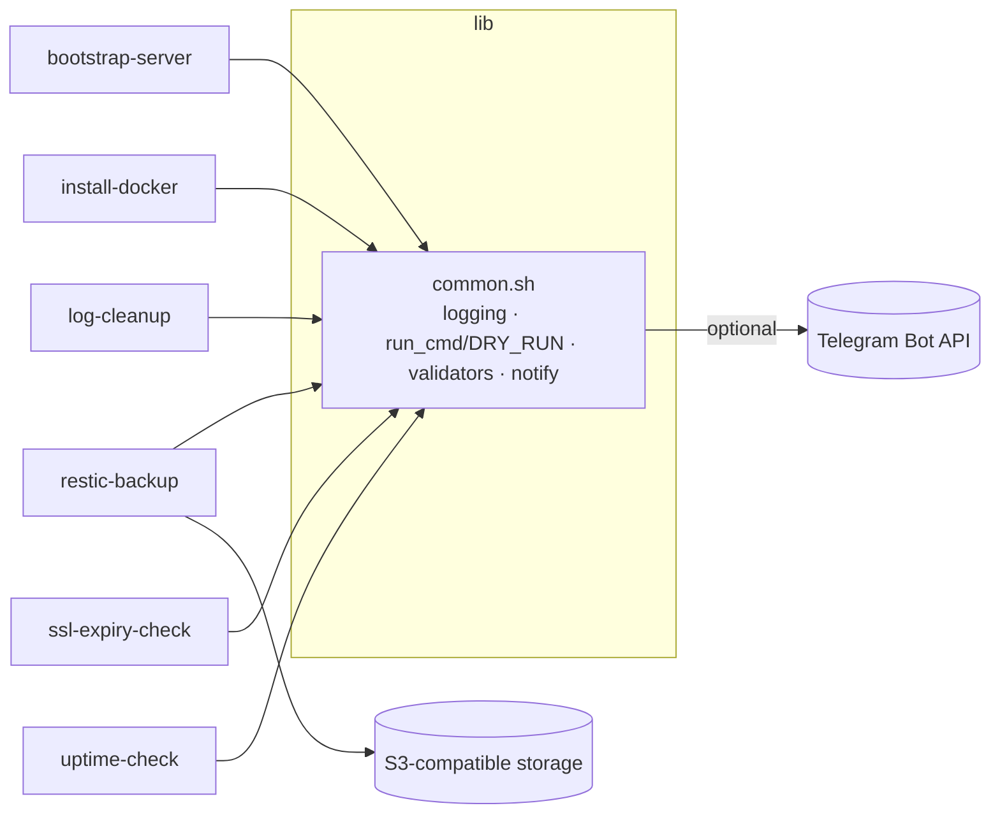

# devops-scripts

[](https://github.com/HOFFMAN-ALTERNATIVE/devops-scripts/actions/workflows/ci.yml)


A polished Bash toolbox for running Linux servers: bootstrap a fresh VPS, install Docker,
take encrypted off-site backups, reclaim disk space, and monitor TLS certificates and uptime.

**Why:** most "server setup" gists are copy-paste one-offs. These scripts are idempotent,
argument-validated, `set -euo pipefail`, support `DRY_RUN=1` previews, ShellCheck-clean and covered by
[bats](https://github.com/bats-core/bats-core) tests in CI.

| Script | What it does |
|---|---|
| `bin/bootstrap-server.sh` | Admin user with key-only login, SSH hardening drop-in (validated with `sshd -t`), UFW deny-by-default with rate-limited SSH, fail2ban, unattended-upgrades |
| `bin/install-docker.sh` | Docker Engine + Compose plugin from the official apt repo (Debian/Ubuntu) |
| `bin/restic-backup.sh` | Encrypted, deduplicated backups to any S3-compatible storage with retention policy and failure alerts |
| `bin/log-cleanup.sh` | Vacuum journald, delete old rotated logs, truncate oversized Docker logs |
| `bin/ssl-expiry-check.sh` | TLS expiry for many hosts, warn/critical thresholds, Nagios-style exit codes |
| `bin/uptime-check.sh` | TCP port and HTTP(S) status checks with retries |

All alerting is optional: set `TG_TOKEN` and `TG_CHAT` to receive Telegram notifications.

## Quick start

```bash
git clone https://github.com/HOFFMAN-ALTERNATIVE/devops-scripts.git && cd devops-scripts

# Preview everything first
DRY_RUN=1 ./bin/bootstrap-server.sh --user deploy --pubkey-file ~/.ssh/id_ed25519.pub \
  --ssh-port 2222 --allow 80 --allow 443

# Apply (as root on the server)
sudo ./bin/bootstrap-server.sh --user deploy --pubkey-file /root/deploy.pub --ssh-port 2222 --allow 80 --allow 443
sudo ./bin/install-docker.sh deploy

# Backups
cp examples/restic.env.example /etc/restic.env && chmod 600 /etc/restic.env   # edit values
sudo ./bin/restic-backup.sh --env-file /etc/restic.env --init
sudo ./bin/restic-backup.sh --env-file /etc/restic.env

# Monitoring (great as cron / systemd timers)
./bin/ssl-expiry-check.sh -w 21 -c 7 example.com api.example.com:8443
./bin/uptime-check.sh tcp://127.0.0.1:5432 https://example.com/health 'https://example.com/admin#401'
```

## Architecture



## Scheduling example (systemd)

```ini
# /etc/systemd/system/uptime-check.service
[Service]
Type=oneshot
EnvironmentFile=/etc/devops-alerts.env
ExecStart=/usr/local/lib/devops-scripts/bin/uptime-check.sh https://example.com/health

# /etc/systemd/system/uptime-check.timer
[Timer]
OnCalendar=*:0/5
Persistent=true
[Install]
WantedBy=timers.target
```

## Development

```bash
make lint   # shellcheck
make test   # bats tests/
```

## License

MIT — see [LICENSE](LICENSE).
